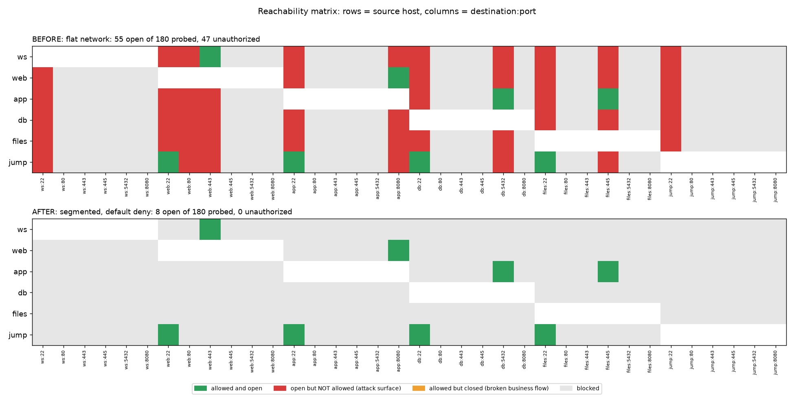
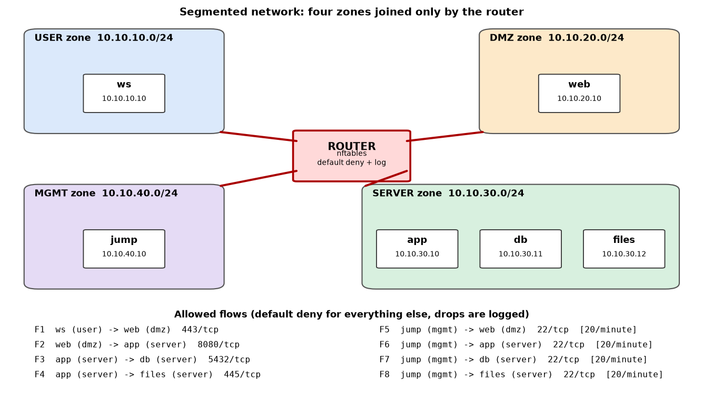

# PS2 Flatland: results report

Approach: **policy-as-code with a proof harness.** One file (`policy.yaml`) lists the business flows. `gen.py` generates the segmented compose file, the router's default-deny nftables ruleset, the host firewall, the business test script and the design tables. `tools/verify.py` then probes every source against every destination and port from inside the containers and checks the result against the policy.

## 1. Attack results (run from the workstation)

| Stage | Behaviour | ATT&CK | Flat network | Segmented network |
|---|---|---|---|---|
| A1 | Port scan from workstation | T1046 | SUCCESS | BLOCKED |
| A2 | SSH login to database host | T1021.004 | SUCCESS | BLOCKED |
| A3 | SMB access to file server | T1021.002 | SUCCESS | BLOCKED |
| A4 | File copy to another host | T1570 | SUCCESS | BLOCKED |
| A5 | Remote system discovery | T1018 | SUCCESS | BLOCKED |

SUCCESS = attacker wins. BLOCKED = defense works. Detail from the flat run:

- A1: scan exposed 9 services beyond the web portal: 10.10.0.20:22 10.10.0.20:80 10.10.0.20:443 10.10.0.30:22 10.10.0.30:8080 10.10.0.31:22 10.10.0.31:5432 10.10.0.32:22 10.10.0.32:445 10.10.0.40:22 
- A2: logged in to db as dbadmin
- A3: listed //files/public (secret.txt visible)
- A4: payload copied to files:/tmp/payload
- A5: sweep discovered 4 other hosts

## 2. Business flows (must pass in both networks)

| ID | Flow | Flat | Segmented |
|---|---|---|---|
| F1 | ws to web:443 (Users reach the web portal over HTTPS) | PASS | PASS |
| F2 | web to app:8080 (Web tier calls the app API) | PASS | PASS |
| F3 | app to db:5432 (App reads and writes the database) | PASS | PASS |
| F4 | app to files:445 (App stores documents on the file server) | PASS | PASS |
| F5 | jump to web:22 (Admin SSH to web) | PASS | PASS |
| F6 | jump to app:22 (Admin SSH to app) | PASS | PASS |
| F7 | jump to db:22 (Admin SSH to database) | PASS | PASS |
| F8 | jump to files:22 (Admin SSH to file server) | PASS | PASS |

Segmented: 8 of 8 business flows pass.

## 3. Reachability proof

- Flat network: **55** host/port pairs open, **47** not in the policy.
- Segmented: **8** open (exactly the policy flows), **0** unauthorized, 0 business flows broken.
- **Attack surface reduction: 100.0%** (unauthorized reachable pairs).



## 4. Network design



See `generated/flows.md` for the addressing plan, zones and data-flow table.

## 5. Extra defenses (stretch goals)

| Check | Result | Detail |
|---|---|---|
| E1 | PASS | db host cannot call out (host egress filter) |
| E2 | PASS | server-to-user connection blocked at the router |
| E3 | PASS | only the app can reach db:5432 (host micro-segmentation) |
| E5 | PASS | same-zone lateral movement blocked (files cannot reach app:22) |
| E4 | PASS | SSH rate limit: only 20 of 60 rapid attempts got through |

## 5b. Negative control: does the proof harness really catch holes?

| Step | Result | Detail |
|---|---|---|
| S1 | PASS | router had a wrong rule but the db host firewall still blocked it (defense in depth) |
| S2 | PASS | harness detected the injected hole (1 unauthorized path: ws -> db:5432) |
| S3 | PASS | rulesets restored, proof passes again (0 unauthorized) |

## 5c. Static policy check and blast radius

```
Policy lint: 8 flows, 0 errors, 0 warnings

Worst-case blast radius if one host is fully compromised
host   flat network   segmented, direct      segmented, by pivoting through allowed flows
ws     5 of 5         web                    app,db,files,web
web    5 of 5         app                    app,db,files
app    5 of 5         db,files               db,files
db     5 of 5         -                      -
files  5 of 5         -                      -
jump   5 of 5         app,db,files,web       app,db,files,web
```

Blast radius assumes the attacker fully controls the host and chains the allowed flows. In the flat network any host reaches every other host directly.


## Dropped traffic seen at the router (105 packets, 30 distinct src/dst/port)

- **ws** (user zone): 105 dropped packets to 30 host/port targets. Behaviour: T1046 service discovery, T1018 remote system discovery, T1021.004 SSH attempt, T1021.002 SMB attempt

| Source (zone) | Destination (zone) | Port | Dropped packets |
|---|---|---|---|
| ws (user) | db (server) | 22 | 7 |
| ws (user) | files (server) | 22 | 7 |
| ws (user) | files (server) | 445 | 7 |
| ws (user) | files (server) | 139 | 5 |
| ws (user) | app (server) | 443 | 4 |
| ws (user) | jump (mgmt) | 443 | 4 |
| ws (user) | db (server) | 443 | 4 |
| ws (user) | files (server) | 443 | 4 |
| ws (user) | app (server) | 22 | 4 |
| ws (user) | jump (mgmt) | 22 | 4 |
| ws (user) | web (dmz) | 22 | 4 |
| ws (user) | web (dmz) | 80 | 4 |
| ws (user) | db (server) | 445 | 4 |
| ws (user) | app (server) | 80 | 4 |
| ws (user) | files (server) | 80 | 4 |


## 6. MITRE mapping

| Stage | Technique | D3FEND | Mitigation |
|---|---|---|---|
| A1 Port scan from workstation | T1046 | Network Isolation | M1030, M1037 |
| A2 SSH login to database host | T1021.004 | Inbound Traffic Filtering | M1030, M1037 |
| A3 SMB access to file server | T1021.002 | Inbound Traffic Filtering | M1030, M1037 |
| A4 File copy to another host | T1570 | Outbound Traffic Filtering | M1030, M1037 |
| A5 Remote system discovery | T1018 | Network Isolation | M1030 |

## 7. Limits and known evasions

- The proof harness probes TCP on six ports. UDP and ICMP are not probed; the router drops everything not listed, but this was not measured.
- Same-zone traffic: on this Docker Desktop kernel it also passes the router's forward chain (br_netfilter), and the probe confirms it is blocked. To avoid depending on that kernel setting, every host also has its own default-deny input firewall (check E5 and self-test S1 show both layers).
- Allowed flows can still be abused (for example SSH from the jump host), which is why they are rate limited.
- Test credentials (`Password123`) are deliberately weak and exist only in the lab image.
